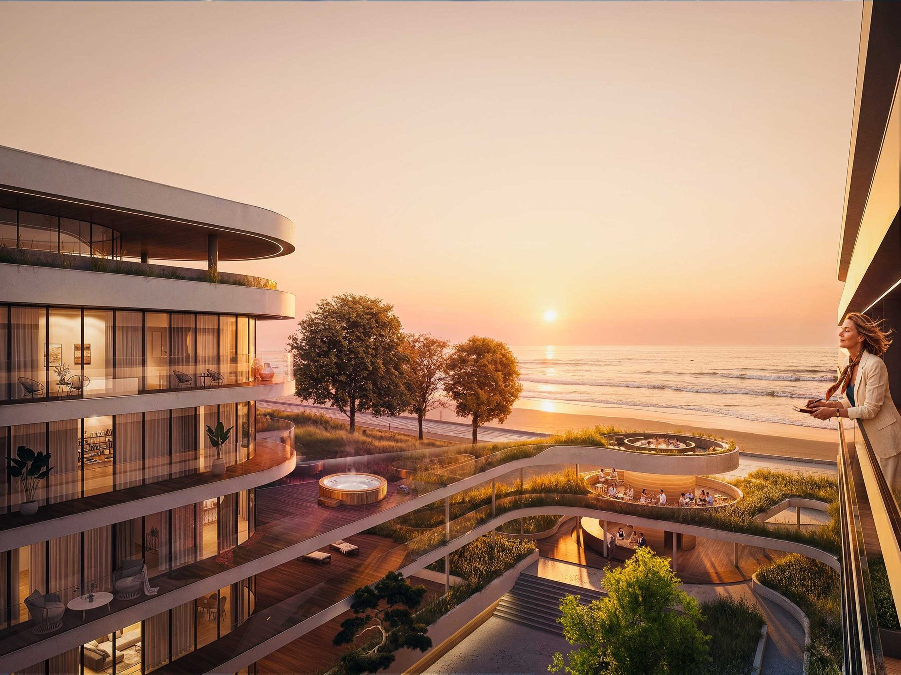
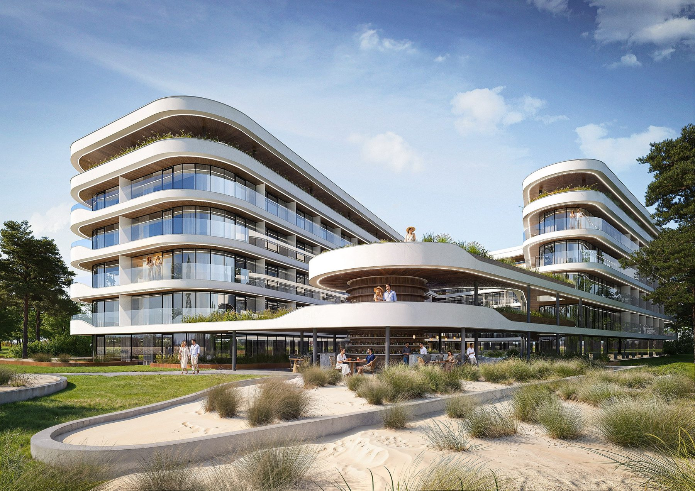
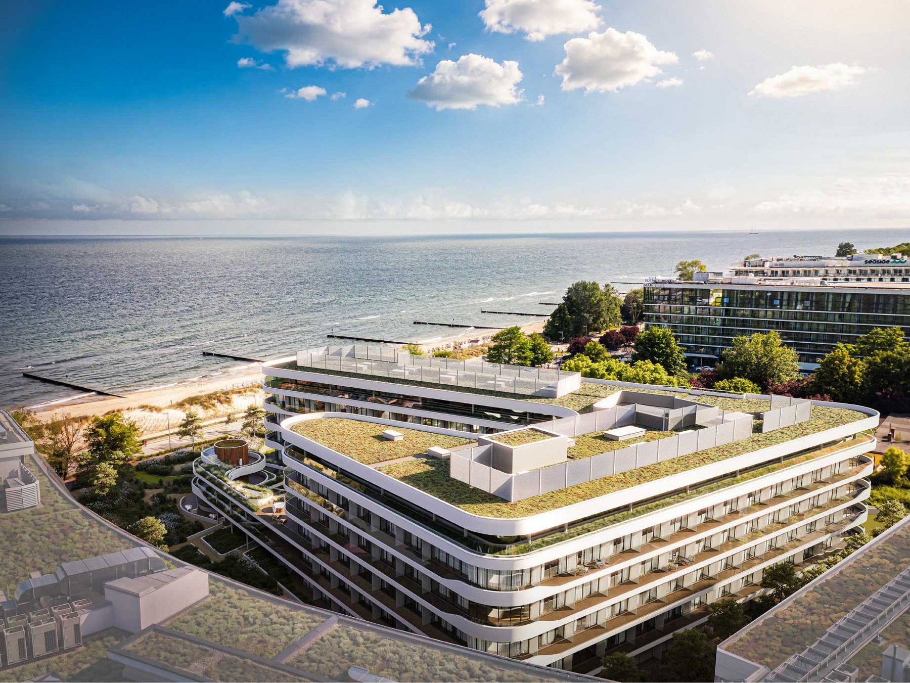

# 10. Unique Hotel Kołobrzeg · Sułkowskiego 7

**Sekcja:** Unique Hotel Kołobrzeg  
**Nagłówek:** MARVIPOL DEVELOPMENT · NADZÓR PROJEKTOWY

**Metryka:** 227 jednostek · Kołobrzeg · Hotel w standardzie 5 gwiazdek · Operator: Unique Hotels & Apartments

Unique Hotel Kołobrzeg to prestiżowa inwestycja apartamentów inwestycyjnych powstająca w pierwszej linii brzegowej przy ul. Sułkowskiego 7 w Kołobrzegu.

---
Opis strony: Otwarcie rozdziału Unique Hotel Kołobrzeg: metryka (227 jednostek, 5 gwiazdek, operator).
