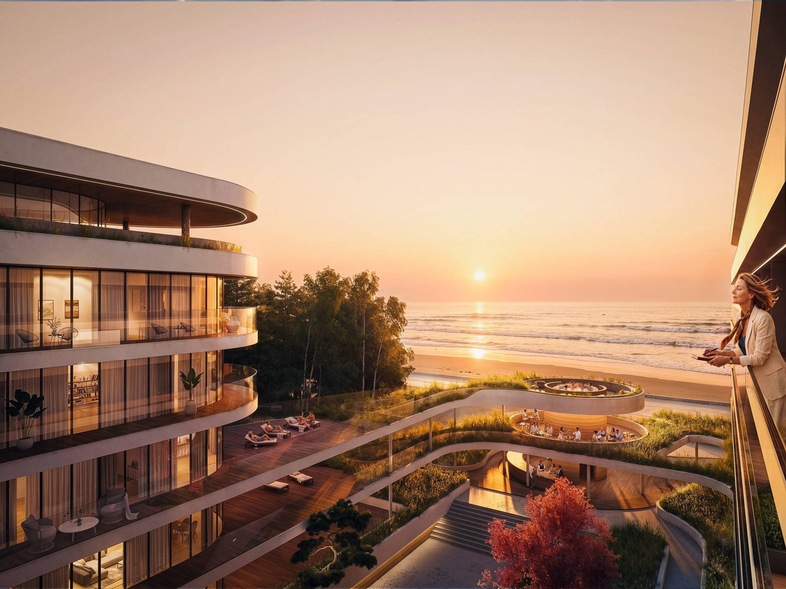
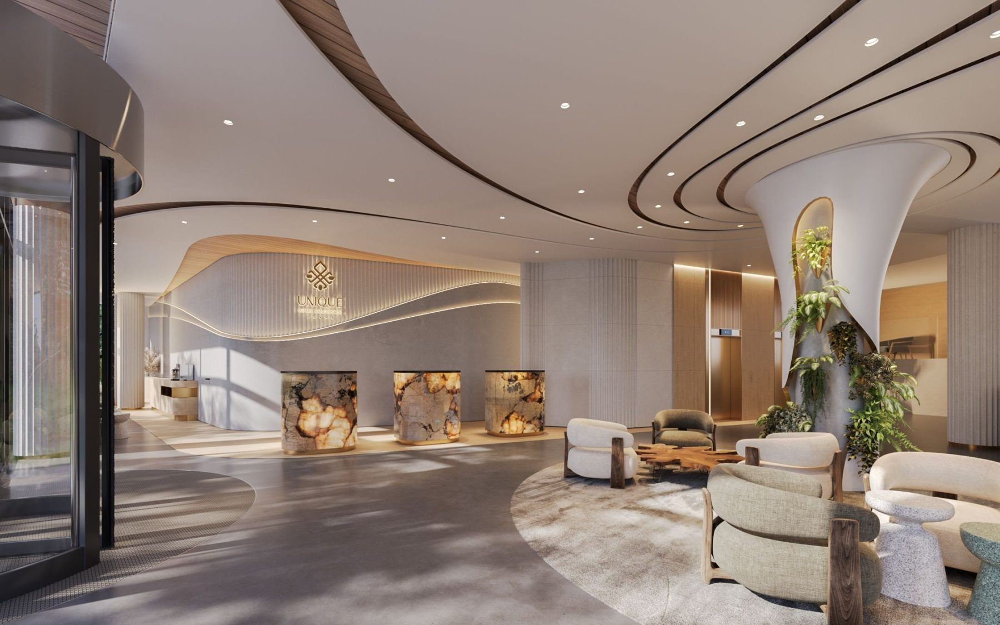
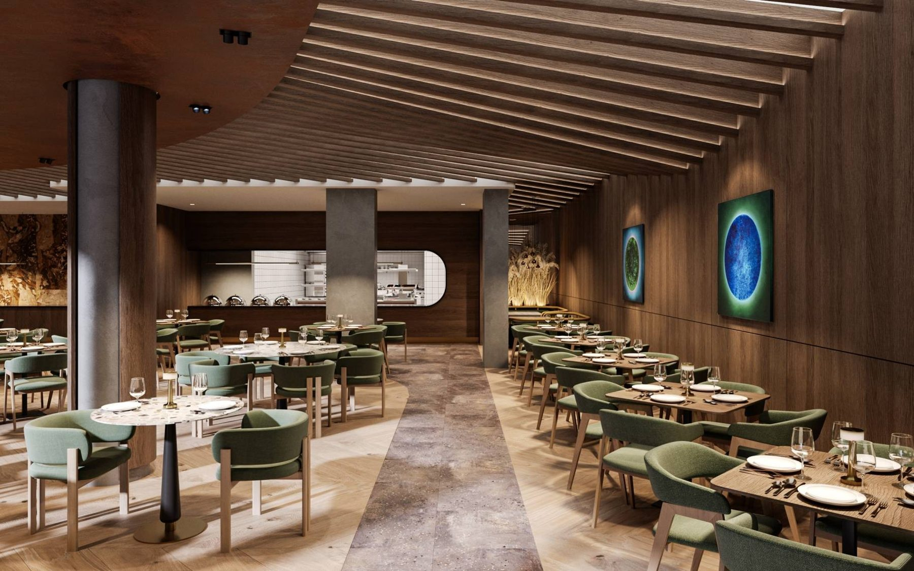
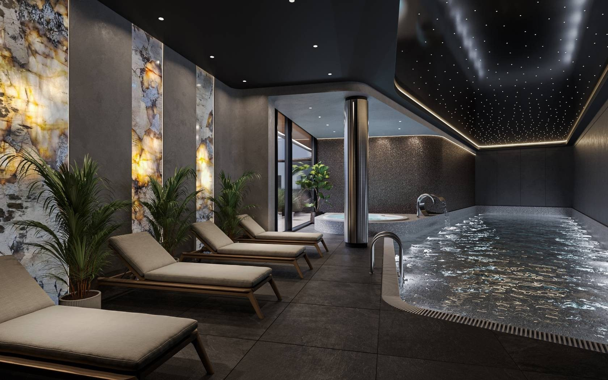
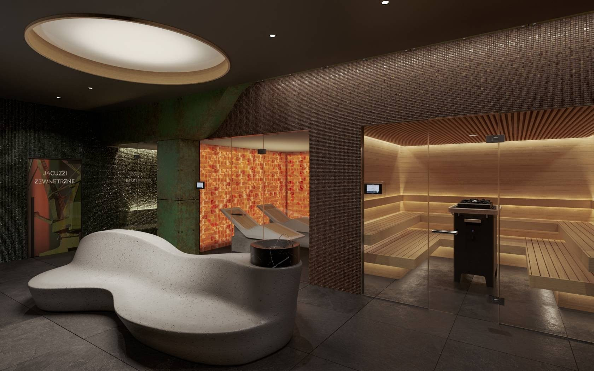
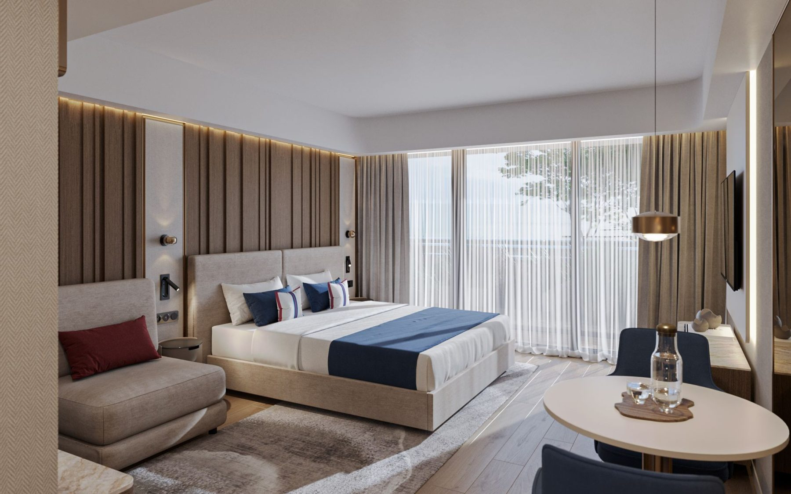
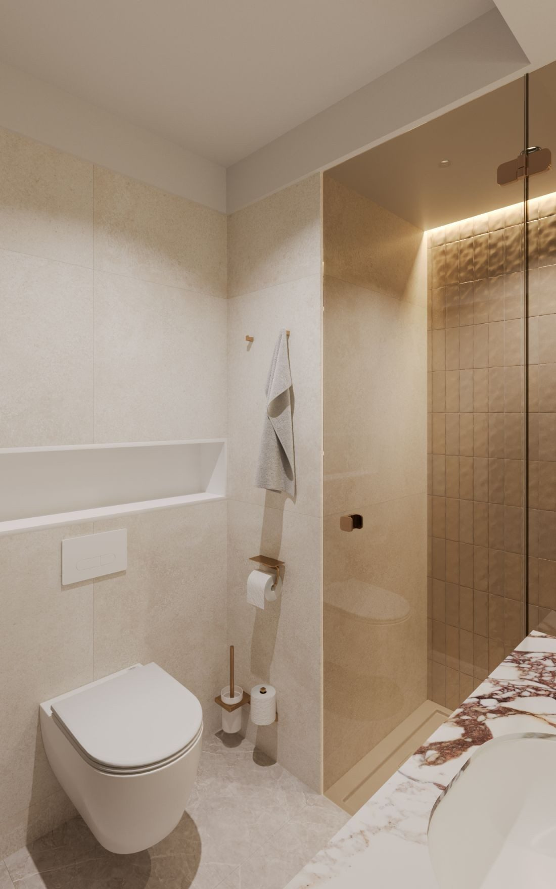

# 11. 227 apartamentów pod klucz w pierwszej linii brzegowej

**Sekcja:** Unique Hotel Kołobrzeg  
**Nagłówek:** OPIS INWESTYCJI

Projekt obejmuje 227 apartamentów wykończonych i wyposażonych pod klucz w standardzie 5-gwiazdkowego hotelu, zarządzanych przez doświadczonego operatora Unique Hotels & Apartments.

Do dyspozycji właścicieli i gości będzie bogata strefa wellness obejmująca SPA z saunami, basen, jacuzzi, restaurację, Beach Bar, gabinety odnowy biologicznej oraz całodobową recepcję. Inwestycja łączy wyjątkową lokalizację nad samym morzem, wysoki standard wykończenia oraz bezobsługowy model inwestycyjny.

## Rezultat

Inwestycja w budowie: 227 apartamentów wykończonych i wyposażonych pod klucz w standardzie 5-gwiazdkowego hotelu, pod operatorem Unique Hotels & Apartments.

*Wizualizacje: KM Rubaszkiewicz · mat. Marvipol Development. Inwestycja w budowie — wnętrza to wizualizacje, nie fotografie realizacji.*

---
Opis strony: Pełny opis inwestycji w Kołobrzegu i zakres nadzoru projektowego; wizualizacja biura KM Rubaszkiewicz.
