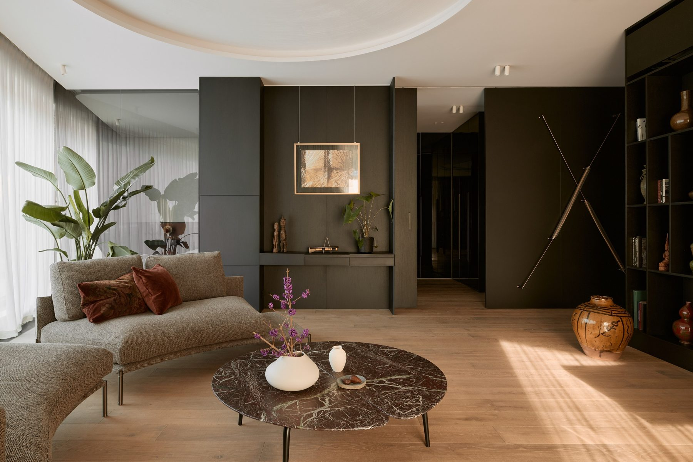

# 12. Rotunda Dynasy M07 · Warszawa · mieszkanie pokazowe

**Sekcja:** Rotunda Dynasy M07  
**Nagłówek:** MARVIPOL DEVELOPMENT · NADZÓR PROJEKTOWY

**Metryka:** Powierzchnia 109 m² · Loggia 20,5 m² · Mieszkanie pokazowe · Lokal sprzedany

---
Opis strony: Otwarcie rozdziału Rotunda Dynasy M07: metryka mieszkania pokazowego.
