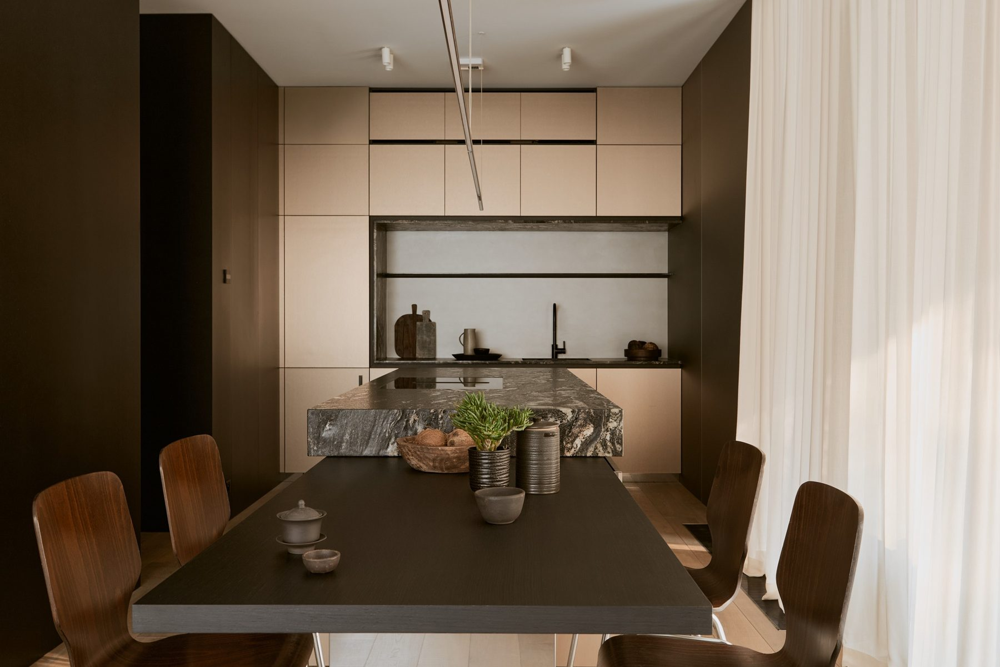
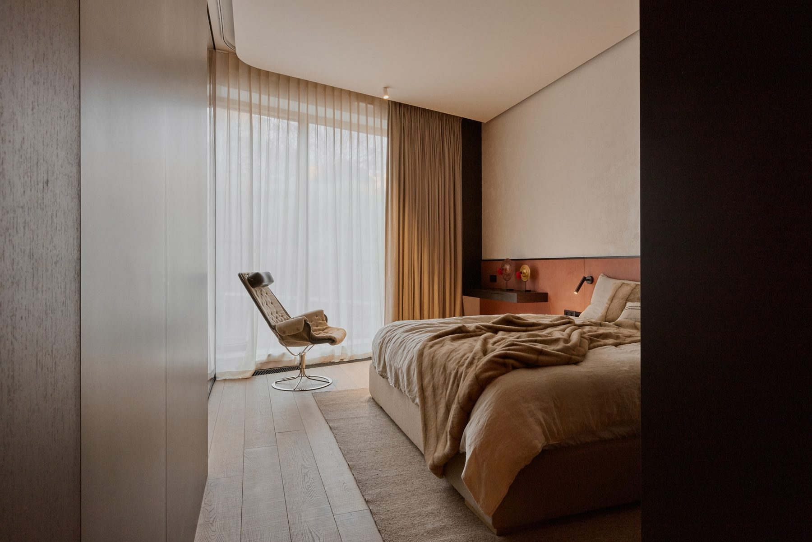

# 13. Przekonywać sposobem życia, nie metrażem

**Sekcja:** Rotunda Dynasy M07  
**Nagłówek:** KONTEKST

Rotunda Dynasy to kameralna inwestycja w sercu Powiśla, wzniesiona na historycznych murach. Mieszkanie M07 miało pełnić funkcję pokazową — przekonywać nie metrażem, lecz sposobem życia, jaki ten metraż umożliwia. Projekt powstał w zewnętrznej pracowni; moim zadaniem było doprowadzenie go do realizacji w założonym standardzie i budżecie.

Mieszkanie pokazowe jest narzędziem sprzedaży, więc punktem wyjścia był profil kupującego na Powiślu i to, które rozwiązania wykończeniowe wytrzymają codzienny ruch zwiedzających.

---
Opis strony: Kontekst i założenia mieszkania pokazowego na Powiślu. Podpisy zdjęć z IDML (edycja PL/EN).
