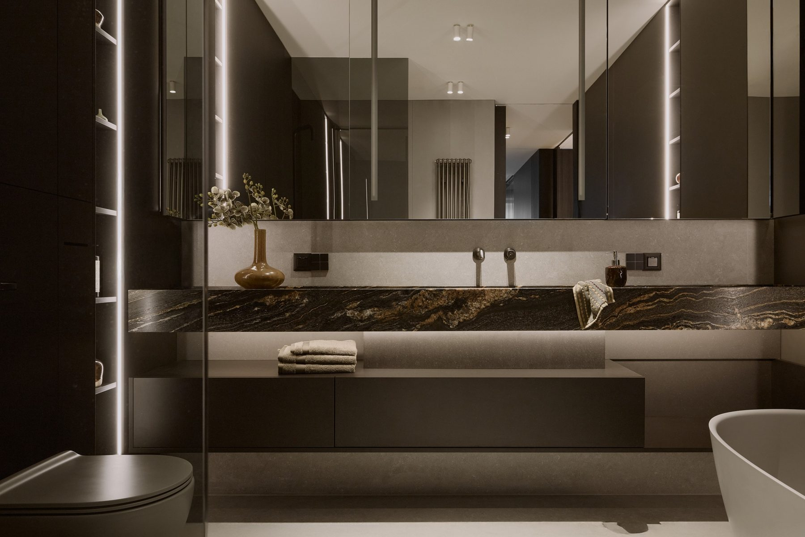
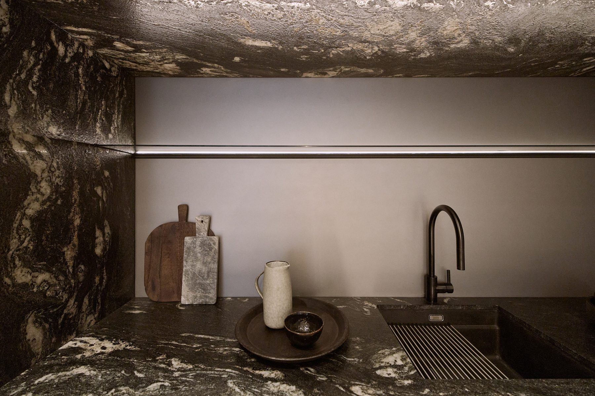
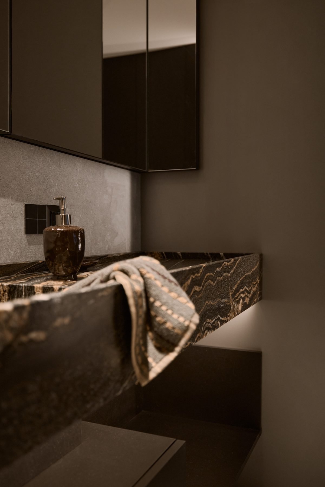
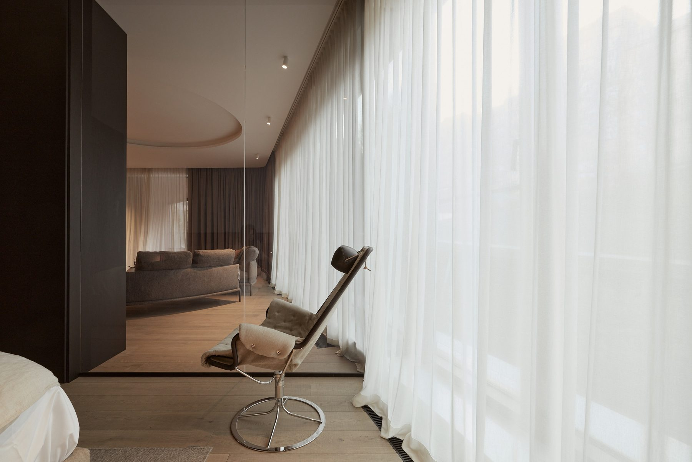

# 14. Naturalne materiały jako priorytet

**Sekcja:** Rotunda Dynasy M07  
**Nagłówek:** PROJEKT M07

Użycie naturalnych materiałów było priorytetem w projekcie mieszkania. Umywalki robione na zamówienie z kamienia.

*Kuchnia i jadalnia · projekt wnętrza: Jakub Skowroński · fot. mat. Marvipol Development*

*Łazienka · projekt wnętrza: Jakub Skowroński · fot. mat. Marvipol Development*

*WSPÓŁPRACA — Projekt wnętrza: Jakub Skowroński · Fotografie: mat. Marvipol Development.*

---
Opis strony: Dokumentacja fotograficzna mieszkania (kuchnia, łazienka) z notą o autorze projektu wnętrza. Podpisy zdjęć z IDML (edycja PL/EN).
