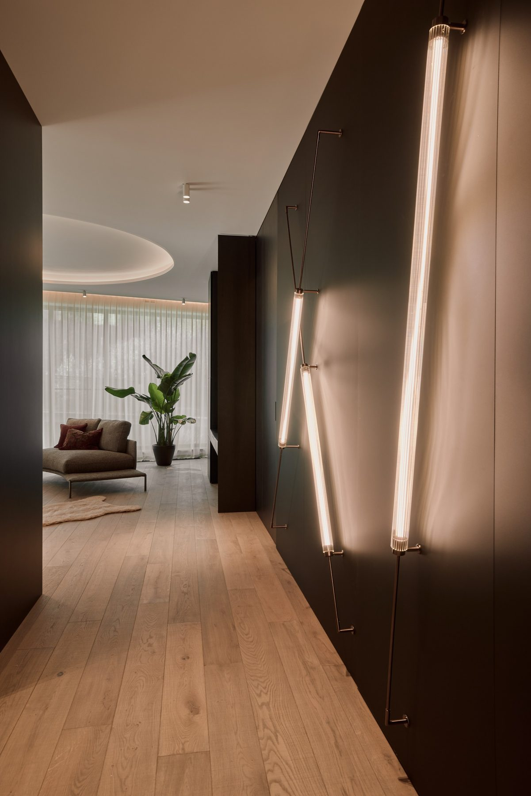

# 15. Cały proces realizacji mieszkania pokazowego

**Sekcja:** Rotunda Dynasy M07  
**Nagłówek:** MOJA ROLA · REZULTAT

## Moja rola

- Prowadziłam cały proces realizacji mieszkania pokazowego
- Odpowiadałam za akceptację materiałów i rozwiązań wykończeniowych
- Prowadziłam optymalizację kosztową i brałam udział w negocjacjach z wykonawcami
- Koordynowałam współpracę pracowni projektowej z wykonawcami

## Rezultat

Mieszkanie pokazowe zrealizowane w założonym standardzie i budżecie; wykorzystywane w komunikacji sprzedażowej inwestycji. Lokal sprzedany.

---
Opis strony: Odpowiedzialności i rezultat: mieszkanie zrealizowane w standardzie i budżecie, sprzedane. Podpisy zdjęć z IDML (edycja PL/EN).
