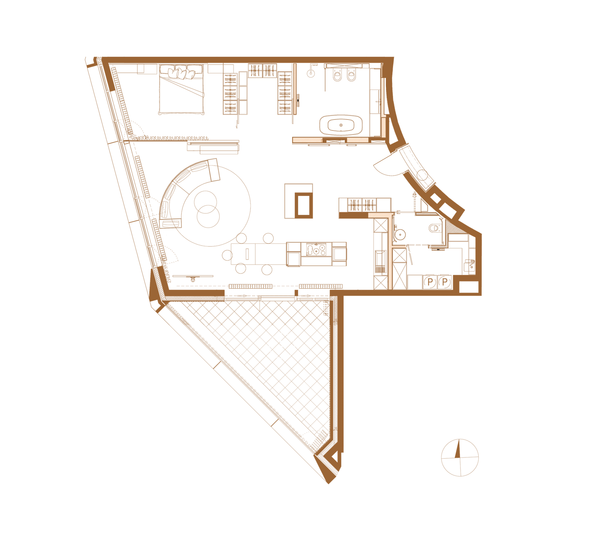

# 16. Rzut mieszkania pokazowego

**Sekcja:** Rotunda Dynasy M07  
**Nagłówek:** RZUT M07

Rzut M07 z zaznaczonymi strefami: dzienna z kuchnią i jadalnią, sypialnia, łazienka, loggia 20,5 m². Układ otwarty, prowadzony pod potrzeby prezentacji sprzedażowej.

*Rzut · mat. Marvipol Development*

---
Opis strony: Strona z rzutem M07 (w .indd: rzut-m07.png / rzut-m07-jasny.png). Podpisy zdjęć z IDML (edycja PL/EN).
