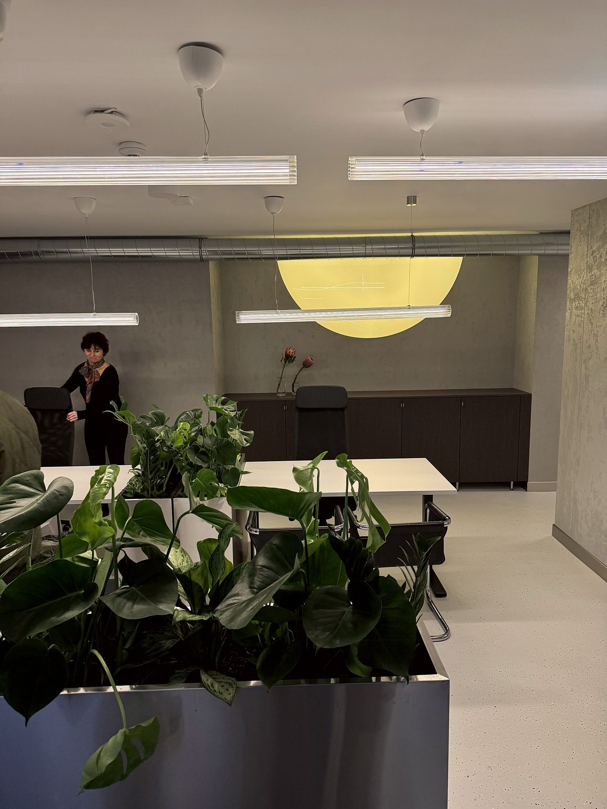
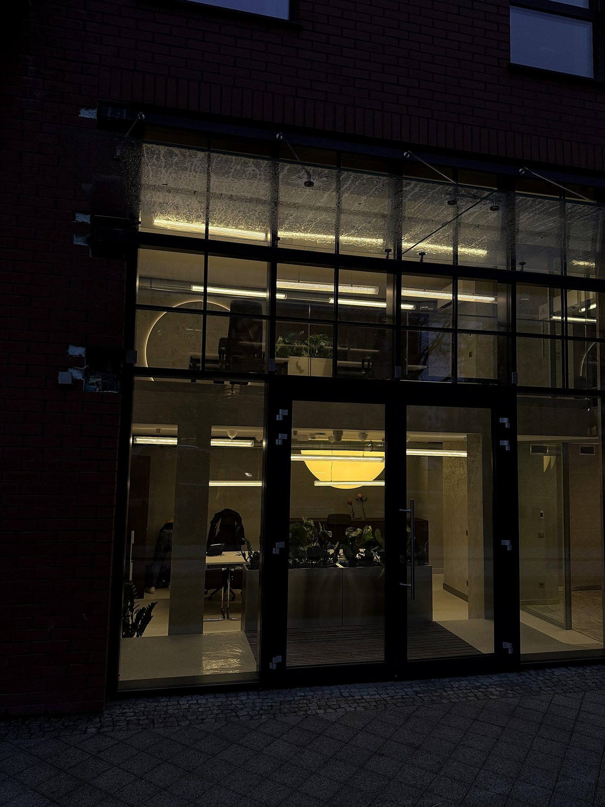
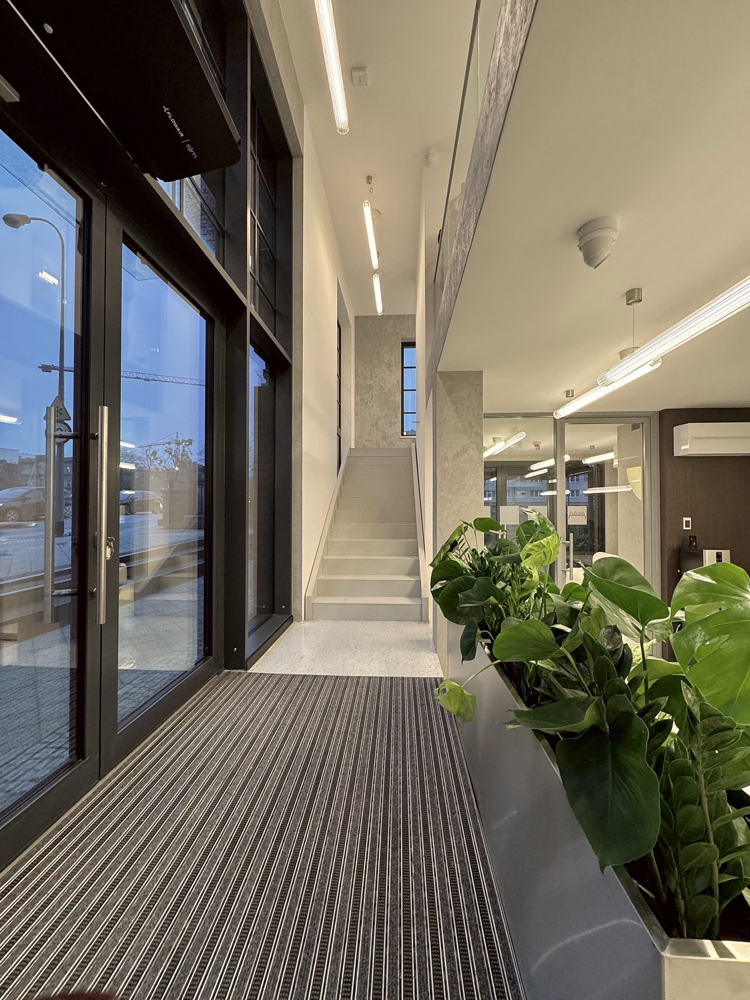

# 17. Biuro sprzedaży · Toruńska 20 · Gdańsk

**Sekcja:** Biuro sprzedaży · Toruńska 20  
**Nagłówek:** MARVIPOL DEVELOPMENT · REALIZACJA

Biuro sprzedaży przy Toruńskiej 20 obsługiwało dwie inwestycje jednocześnie. Przestrzeń musiała więc unieść dwie narracje produktowe naraz, nie stając się przy tym neutralnym tłem dla żadnej z nich. Spójności nadaje jej światło — powtarzalny motyw łuku i okręgu, prowadzony przez całe wnętrze.

*WSPÓŁPRACA — Projekt wnętrza: Design Anatomy · Fotografie: Barbara Iwańska.*

---
Opis strony: Otwarcie rozdziału biura sprzedaży w Gdańsku: dwie narracje produktowe, motyw łuku i okręgu. Podpisy zdjęć z IDML (edycja PL/EN).
