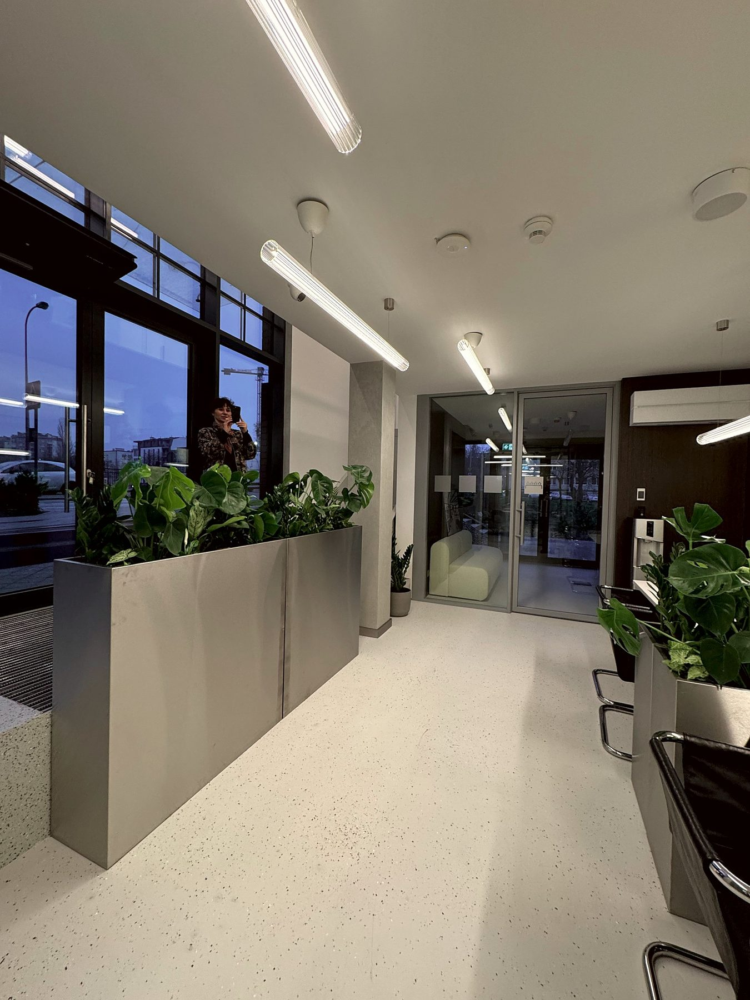
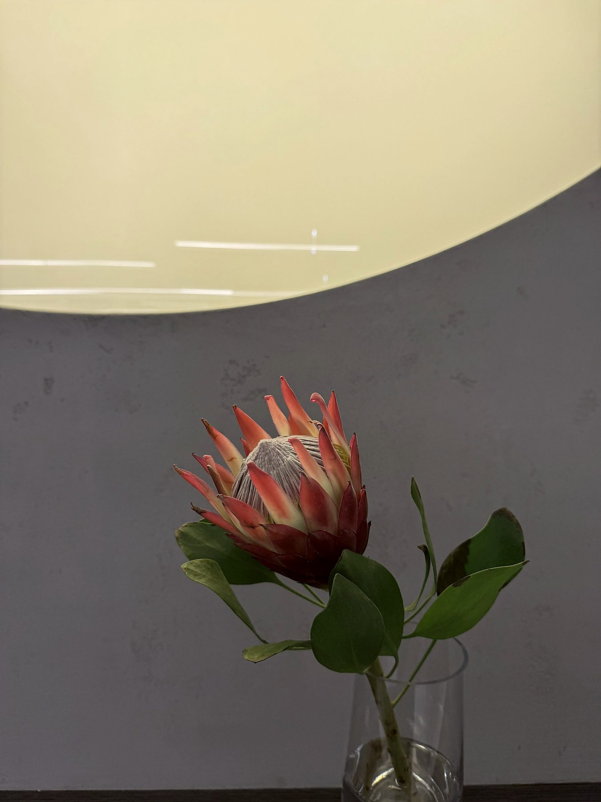
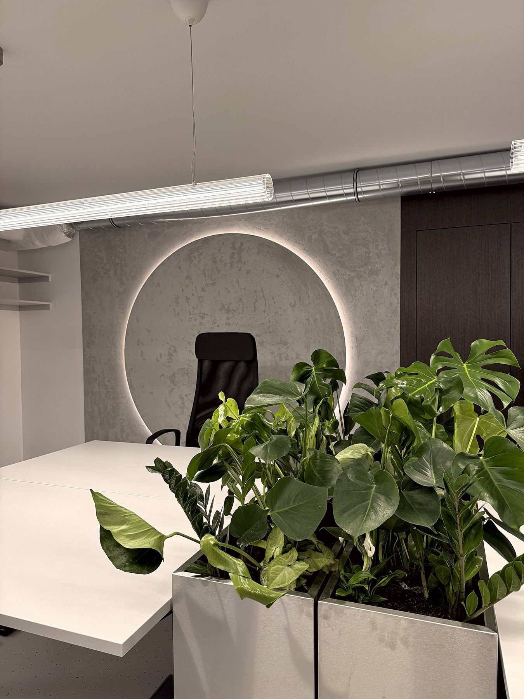
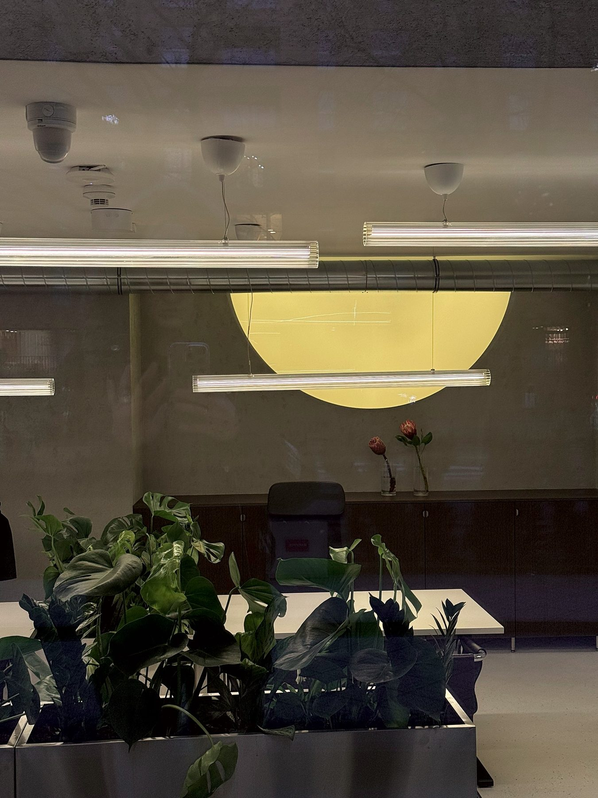
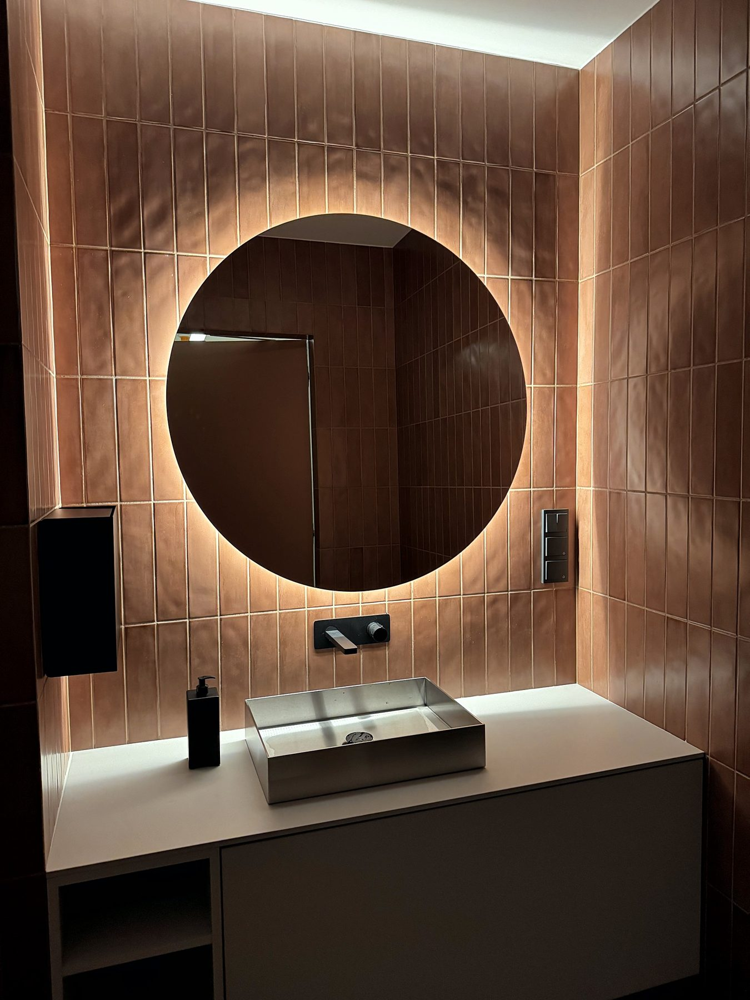

# 18. Instalacja świetlna i koordynacja

**Sekcja:** Biuro sprzedaży · Toruńska 20  
**Nagłówek:** MOJA ROLA · REZULTAT

## Moja rola

- Prowadziłam projekt od strony inwestora, w zespole odpowiedzialnym za realizację
- Odpowiadałam za instalację świetlną — dobór, koordynację z producentem i wdrożenie
- Koordynowałam współpracę z biurem projektowym, wykonawcami i dostawcami

## Rezultat

Biuro zrealizowane; obsługiwało dwie inwestycje jednocześnie.

---
Opis strony: Odpowiedzialności i rezultat realizacji biura sprzedaży.
