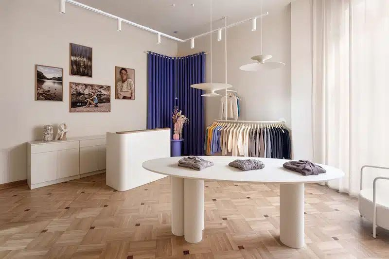
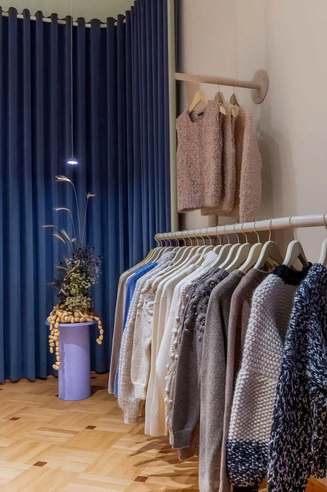

# 19. Kamienica z 1918 roku, stropy na cztery metry

**Sekcja:** B Sides · Mokotowska 61  
**Nagłówek:** KONTEKST

Ponad 100 m² w warszawskiej kamienicy z 1918 roku, stropy wysokie na cztery metry, dębowy parkiet. Przestrzeń miała nieść wartości marki: ponadczasową jakość, rzemiosło, lokalność i etyczne podejście do zwierząt — a jednocześnie dawać domowy komfort w nowoczesnym wydaniu.

---
Opis strony: Kontekst projektu butiku B Sides i wartości marki, które wnętrze miało nieść. Podpisy zdjęć z IDML (edycja PL/EN).
