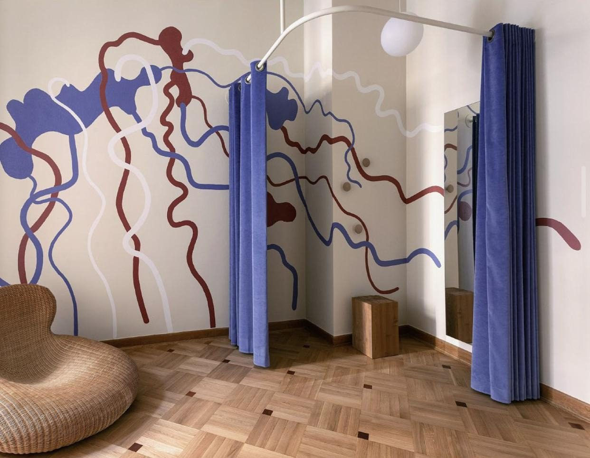

# 20. B Sides · Mokotowska 61 · Warszawa

**Sekcja:** B Sides · Mokotowska 61  
**Nagłówek:** ZOFIA STRUMIŁŁO STUDIO · 2021–2022

**Metryka:** Project Manager, współautorka projektu · 2021–2022 · Ponad 100 m² przestrzeni handlowej · Obiekt zabytkowy

Otwarcie butiku 22.11.2022. Ponad 100 m² przestrzeni handlowej w obiekcie zabytkowym.

---
Opis strony: Otwarcie rozdziału B Sides: rola w Zofia Strumiłło Studio, metryka butiku. Podpisy zdjęć z IDML (edycja PL/EN).
