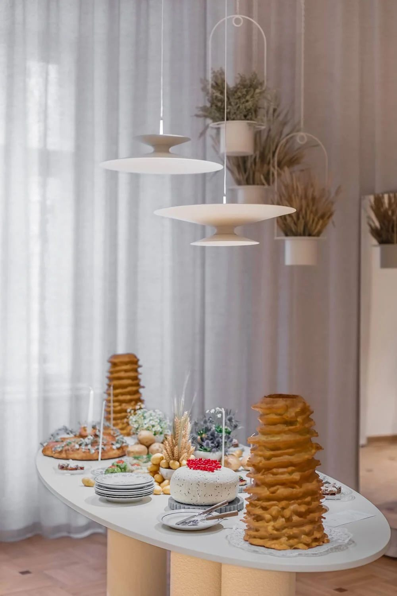
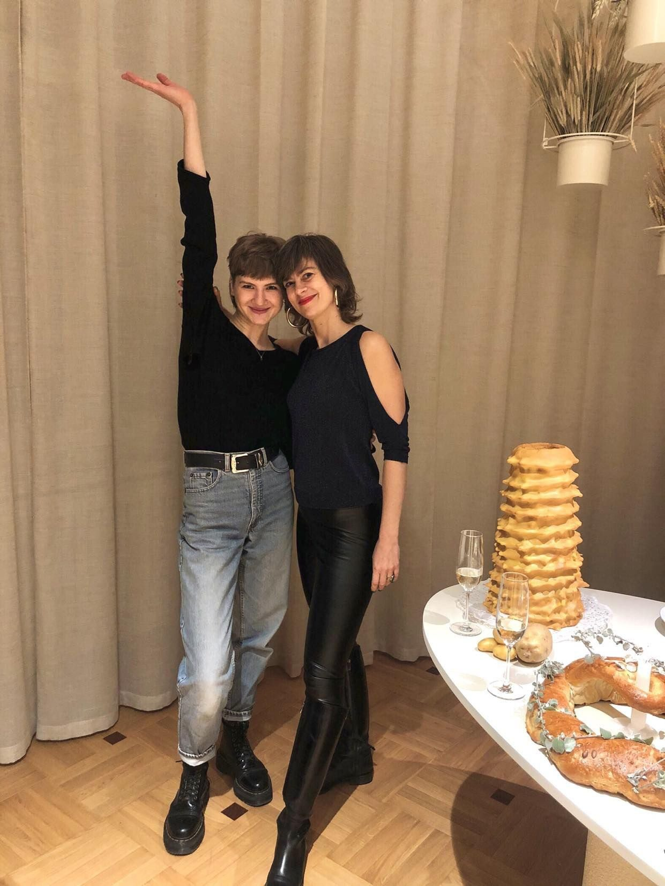

# 21. Rysunki wykonawcze i otwarcie butiku

**Sekcja:** B Sides · Mokotowska 61  
**Nagłówek:** REALIZACJA · OTWARCIE

RYSUNKI WYKONAWCZE — przebudowa układu schodów i stropu.

Otwarcie butiku, 22.11.2022. Współudział w przygotowaniu wydarzenia otwierającego.

*WSPÓŁPRACA — Projekt wnętrza: Zofia Strumiłło STUDIO — Zofia Strumiłło, Barbara Iwańska · Projekt wykończenia i wdrożenie: Barbara Iwańska · Mural: Magdalena Łapińska-Rozenbaum · Oświetlenie: Chors · Zieleń: Bujnie, CosmosPlantea · Fotografie: @w_srodku*

---
Opis strony: Rysunki wykonawcze (schody, strop), galeria realizacji i wydarzenie otwierające. Podpisy zdjęć z IDML (edycja PL/EN).
