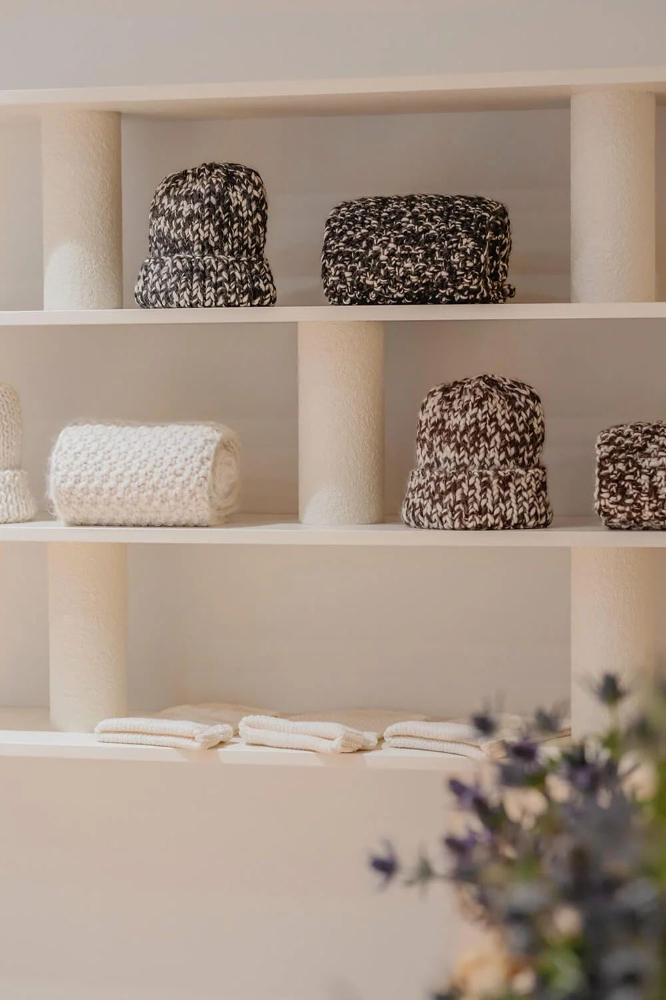
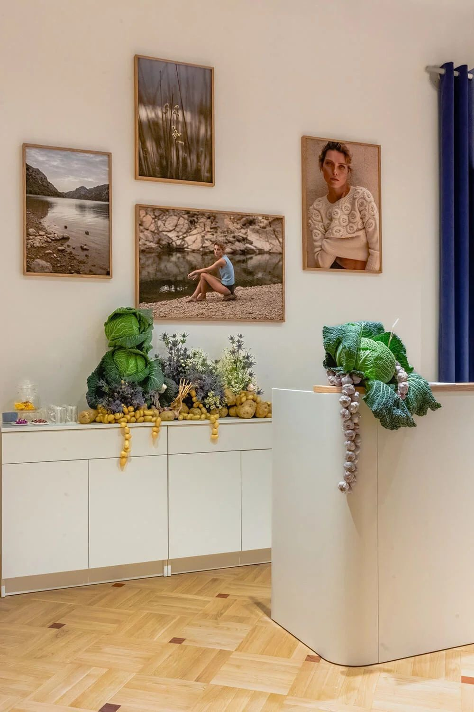

# 22. Pełny cykl projektu — od koncepcji po otwarcie

**Sekcja:** B Sides · Mokotowska 61  
**Nagłówek:** MOJA ROLA

## Moja rola

- Współtworzyłam projekt wnętrza w zespole studia
- Odpowiadałam za projekt wykończenia i jego wdrożenie
- Zarządzałam pełnym cyklem projektu — od koncepcji po otwarcie butiku
- Kontrolowałam budżet i dobór materiałów pod kątem jakości, estetyki i aspektów środowiskowych
- Przygotowywałam dokumentację projektową i prezentacje wspierające decyzje inwestycyjne
- Koordynowałam wykonawców, dostawców i twórców zaangażowanych w realizację

---
Opis strony: Lista odpowiedzialności w projekcie B Sides.
