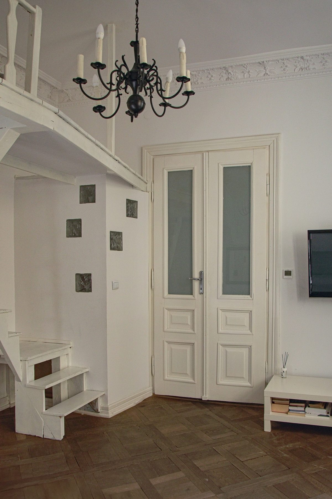
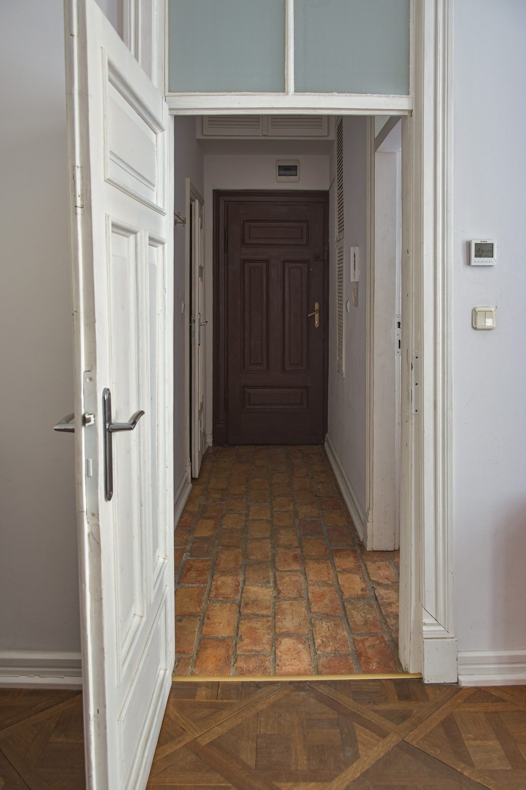

# 25. Nie istniała nazwa, identyfikacja ani język

**Sekcja:** Form Space · Nowogrodzka 44  
**Nagłówek:** KONTEKST

Kamienica przy Nowogrodzkiej 44 w Warszawie miała stać się apart-hotelem w segmencie premium. Nie istniała ani nazwa, ani identyfikacja, ani język, którym inwestycja miałaby mówić do przyszłego użytkownika. Wszystko trzeba było zbudować równolegle z koncepcją samego produktu.

---
Opis strony: Kontekst: budowa marki równolegle z koncepcją produktu.
