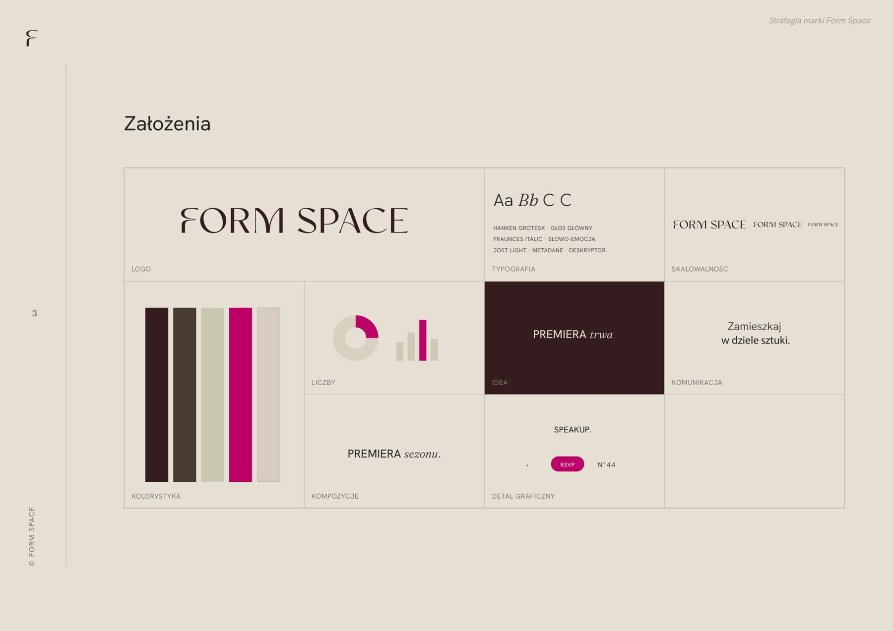

# 26. Koncepcja, strategia, marka, katalog, program wystawienniczy

**Sekcja:** Form Space · Nowogrodzka 44  
**Nagłówek:** MOJA ROLA

## Moja rola

- Opracowałam koncepcję przestrzeni hospitality w zabytkowej kamienicy
- Przygotowałam pełną strategię: pozycjonowanie, analizę benchmarków rynkowych, personę gościa, architekturę marki, słowa kluczowe i ton głosu, rytm komunikacji
- Stworzyłam nazwę, znak i system wizualny marki — od druku po design system strony
- Przełożyłam system na tokeny w konwencji shadcn/ui — tryb jasny i nocny
- Odpowiadałam za katalog Form Space: konspekt, strukturę narracyjną, teksty, skład
- Nawiązałam współpracę z artystkami i objęłam kuratelę nad programem wystawienniczym

---
Opis strony: Lista odpowiedzialności w projekcie Form Space.
