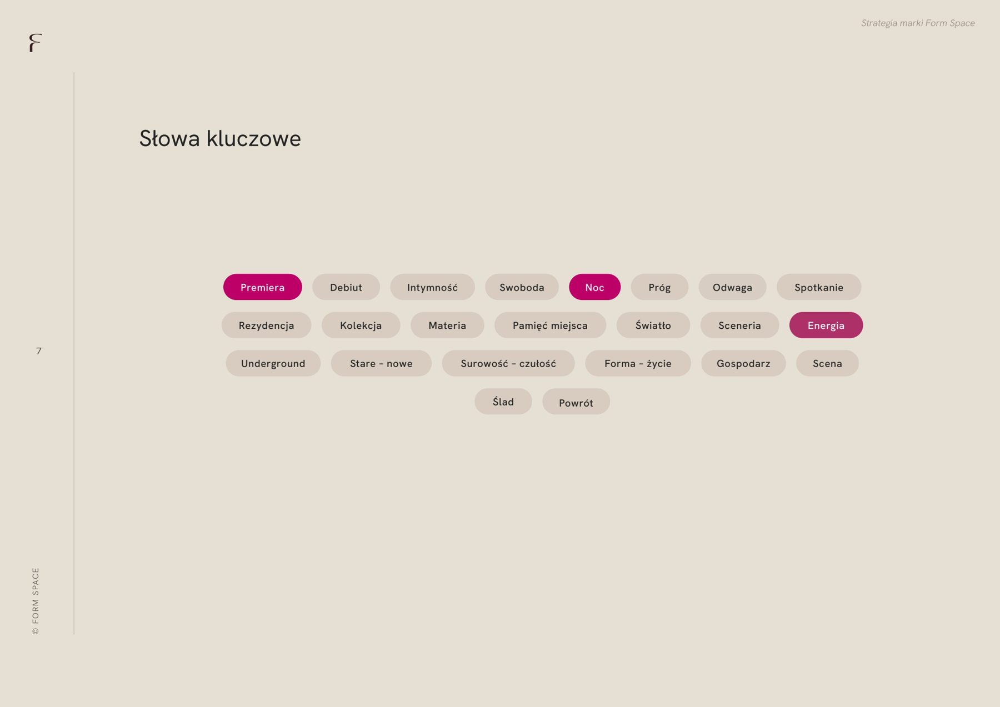
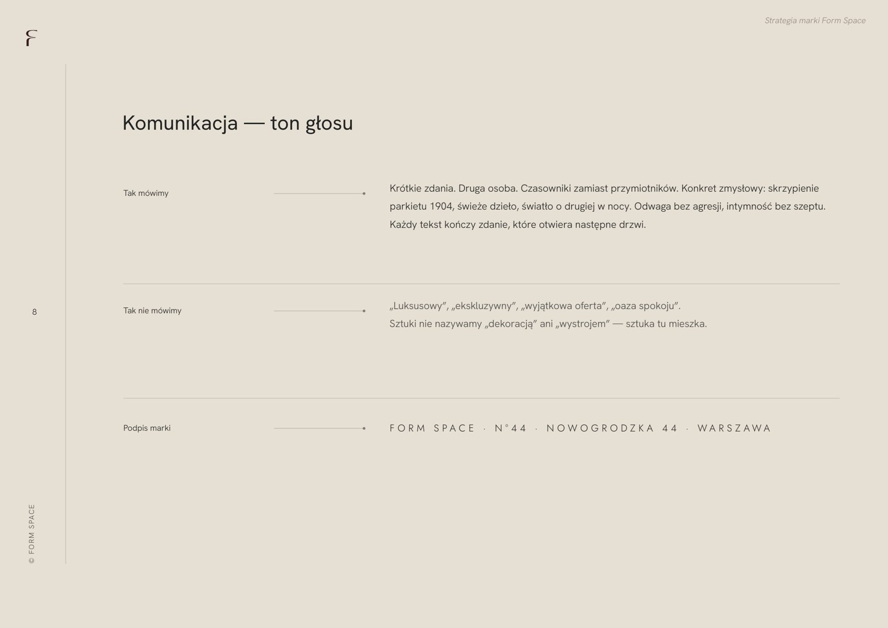
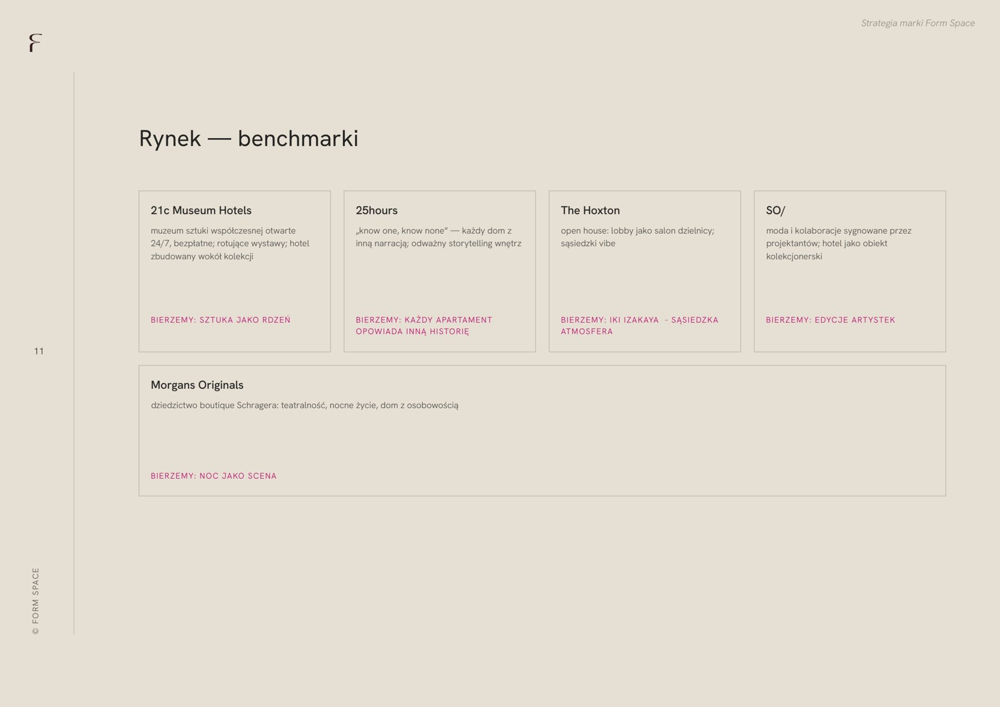
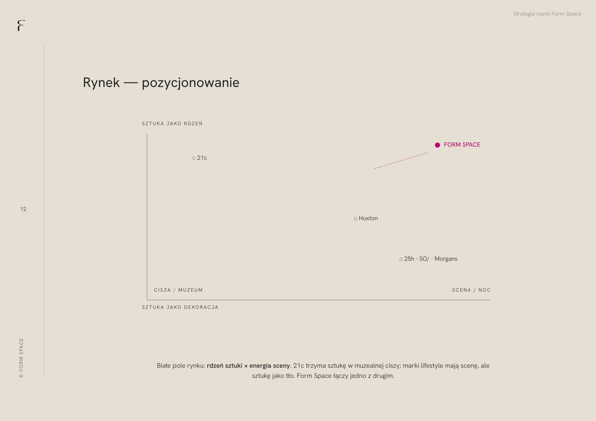
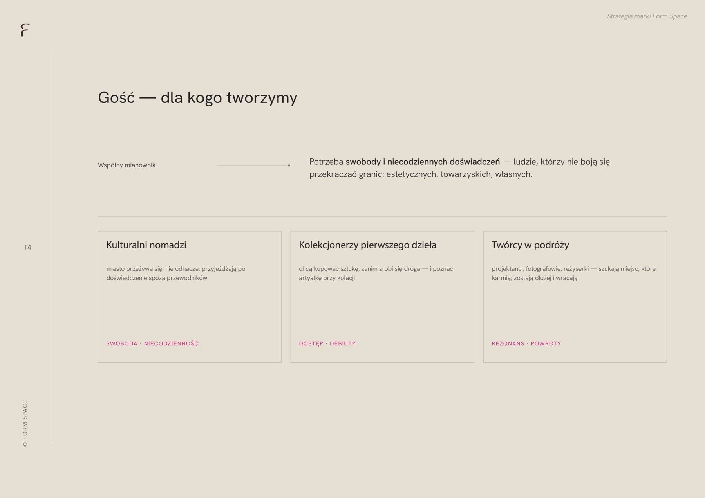

# 27. Kadr z prezentacji — strategia marki Form Space

**Sekcja:** Form Space · Strategia  
**Nagłówek:** STRATEGIA MARKI

Pozycjonowanie, benchmarki rynkowe, persona gościa, architektura marki, słowa kluczowe i ton głosu, rytm komunikacji — pełna strategia opracowana przed powstaniem nazwy i znaku.

*Kadry z prezentacji strategii marki Form Space.*

---
Opis strony: Kadry z prezentacji strategii marki (w .indd: strategia-form-space.pdf).
