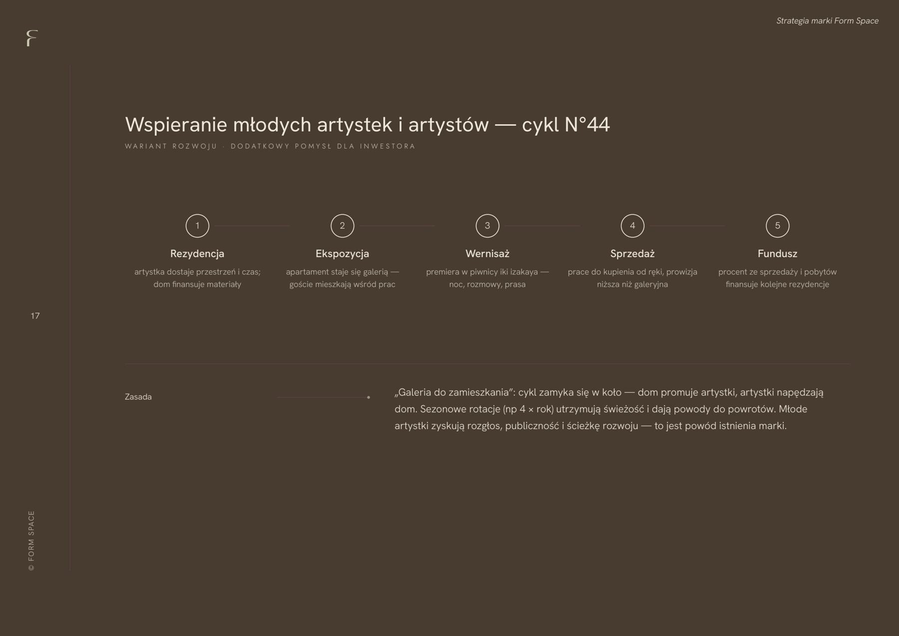
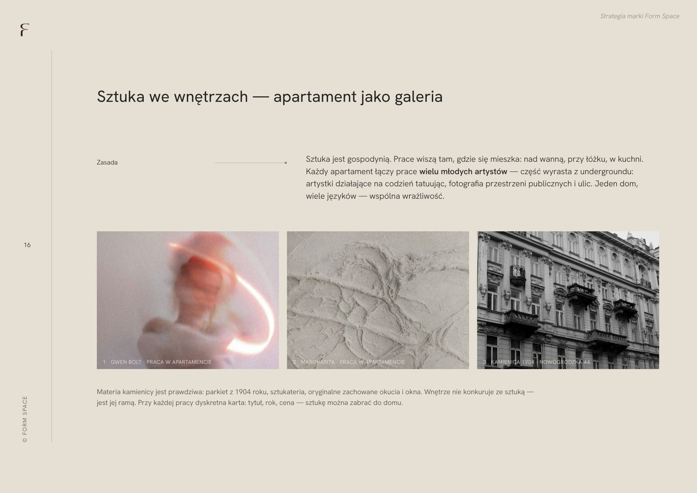
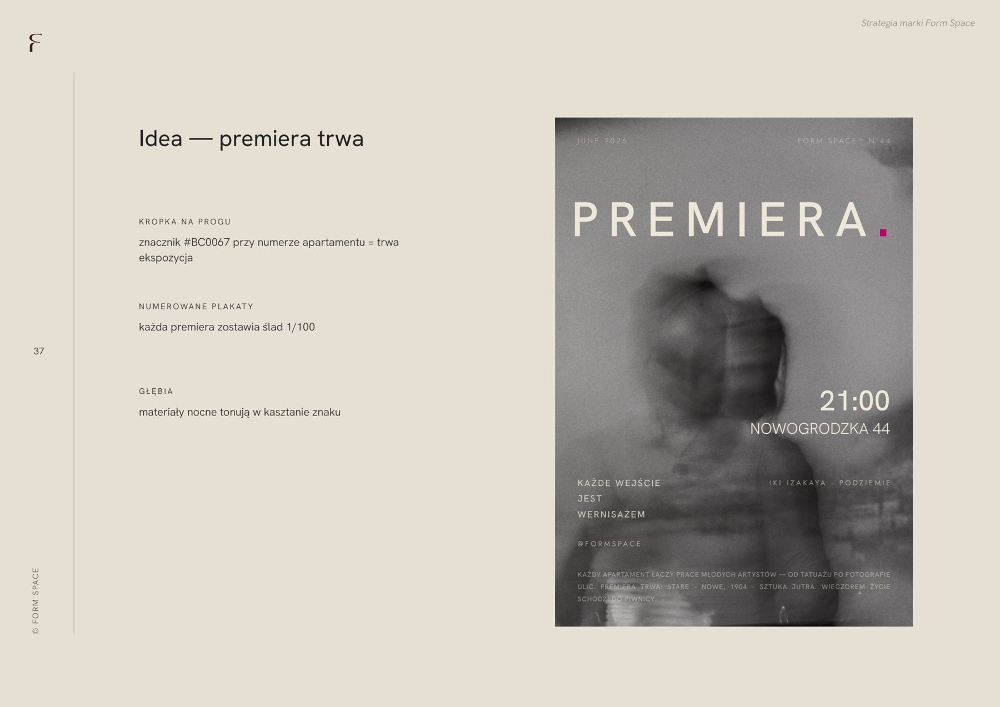
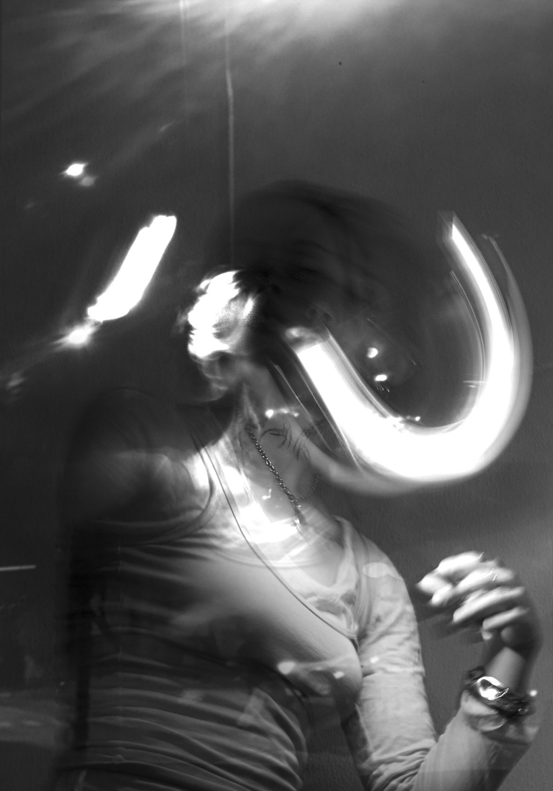
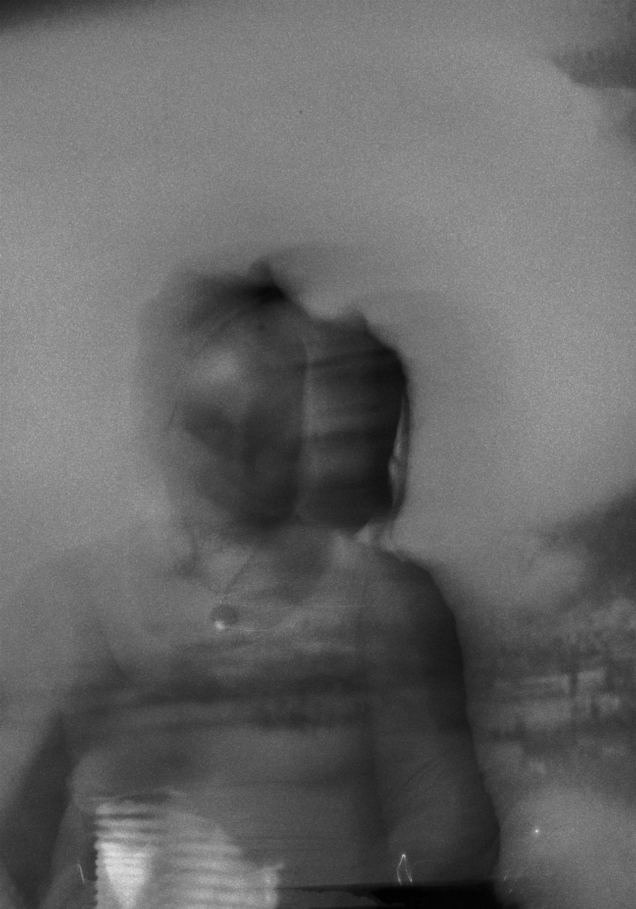
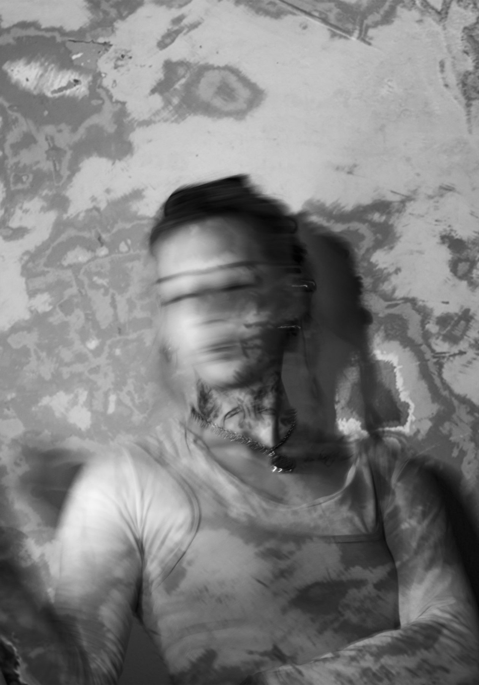
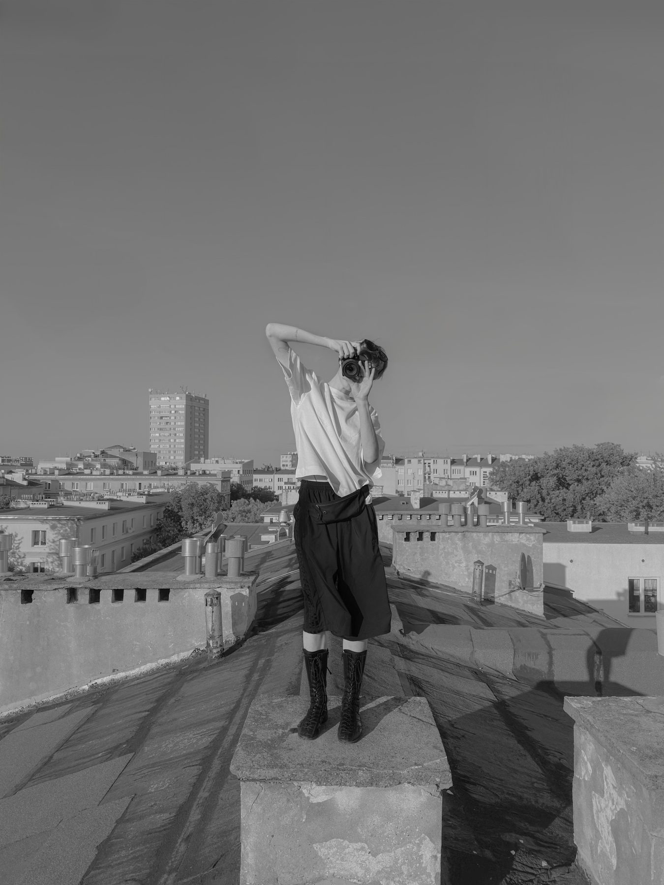

# 27. Program wystawienniczy jako narzędzie PR

**Sekcja:** Form Space · System wizualny  
**Nagłówek:** SYSTEM WIZUALNY

Współpraca z artystkami i kuratela nad programem wystawienniczym. Wystawy w przestrzeni apart-hotelu budują rozpoznawalność marki i dają pretekst do komunikacji.

*Prace z programu wystawienniczego Form Space, fot. Gwen Bolte.*

---
Opis strony: Program wystawienniczy Form Space i jego rola w PR marki.
