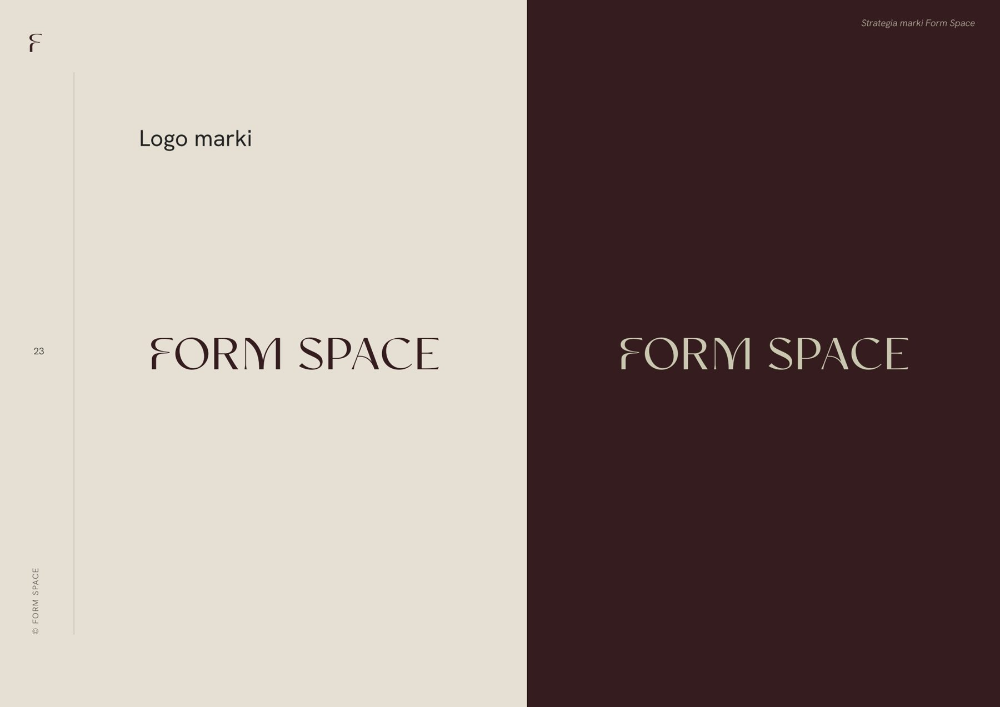
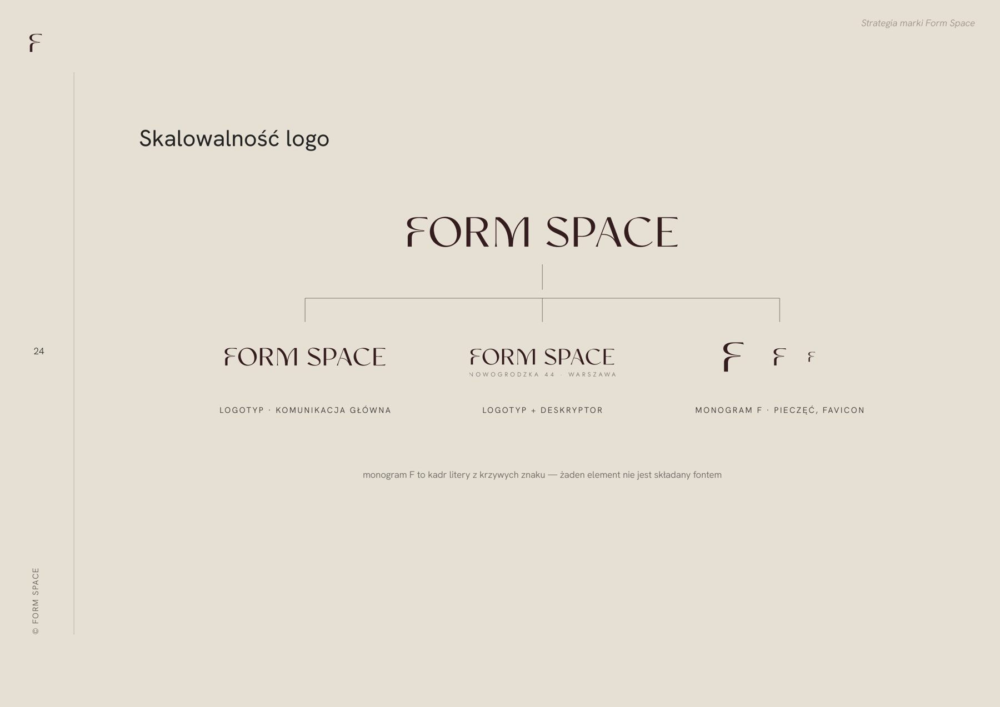
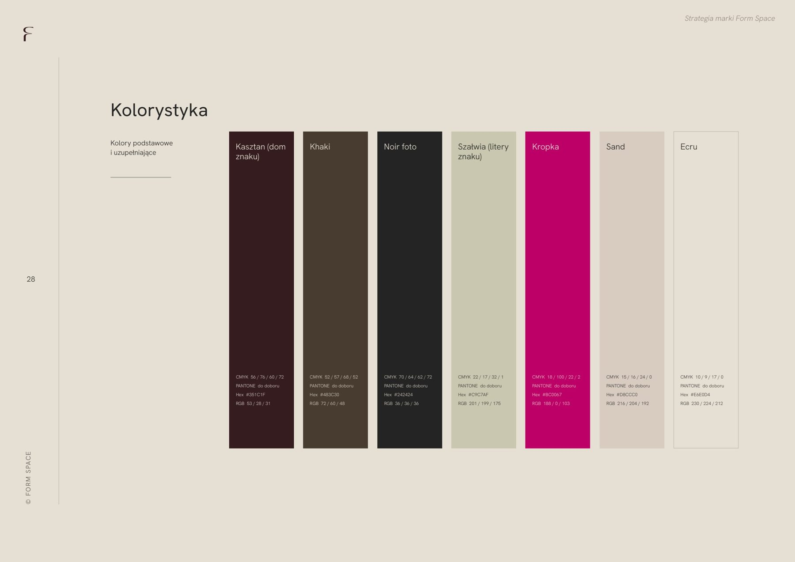
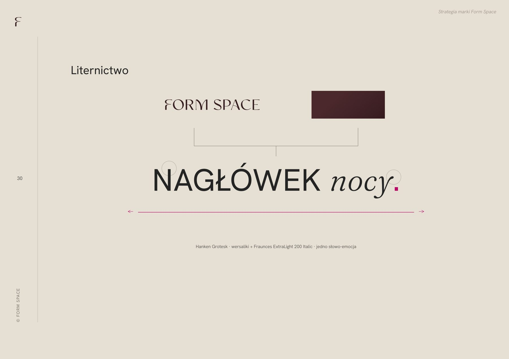
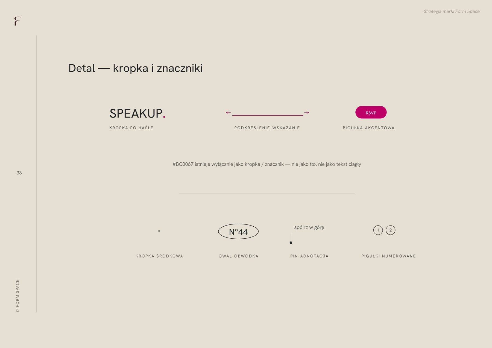

# 28. Marka wdrożona wraz z pełną identyfikacją

**Sekcja:** Form Space · System wizualny  
**Nagłówek:** SYSTEM WIZUALNY

Marka wdrożona wraz z pełną identyfikacją — od druku po stronę. Program wystawienniczy jako narzędzie PR.

---
Opis strony: System wizualny Form Space: nazwa, znak, identyfikacja od druku po stronę.
