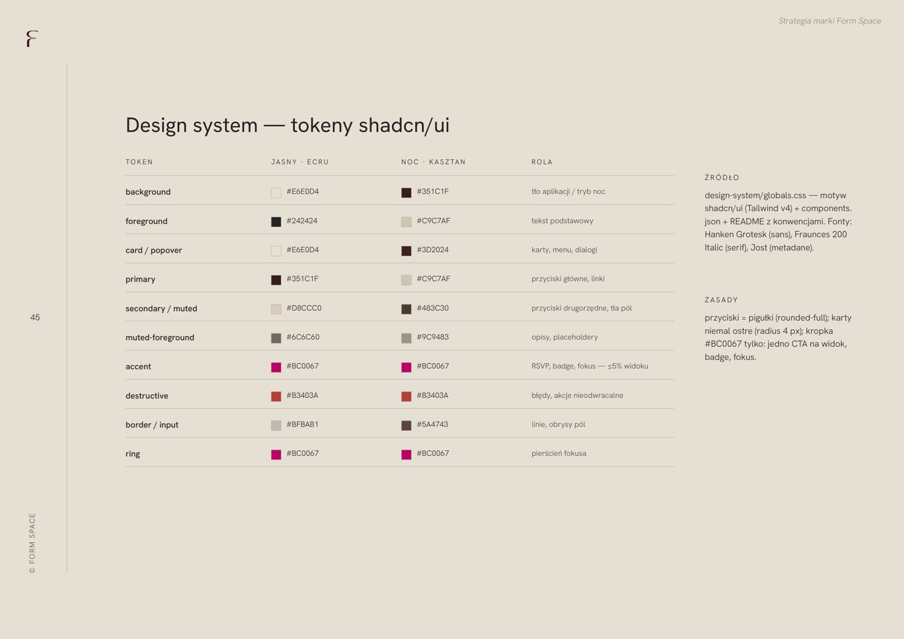
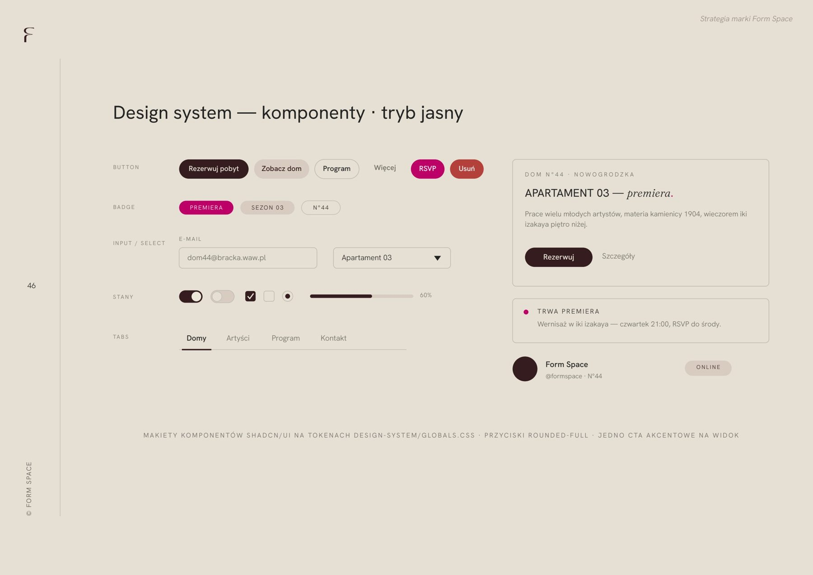
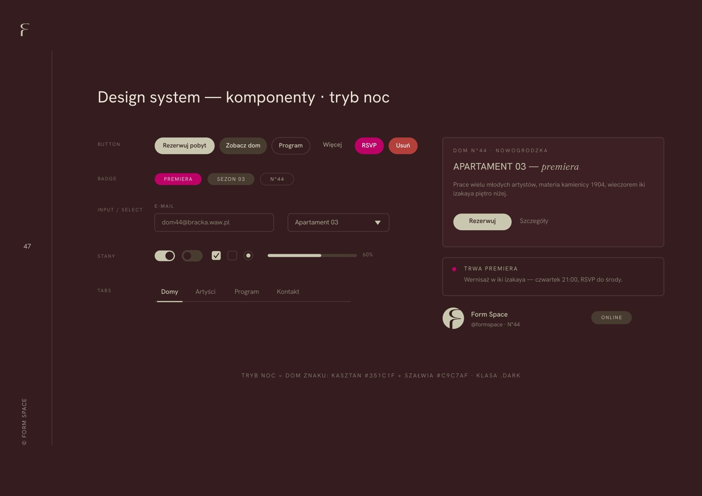

# 30. Tokeny w konwencji shadcn/ui — tryb jasny i nocny

**Sekcja:** Form Space · Design system  
**Nagłówek:** DESIGN SYSTEM

System wizualny przełożony na tokeny w konwencji shadcn/ui. Dwa motywy: jasny i nocny. Komponenty strony wynikają bezpośrednio z identyfikacji drukowanej.

---
Opis strony: Design system strony Form Space: tokeny, motyw jasny i nocny.
