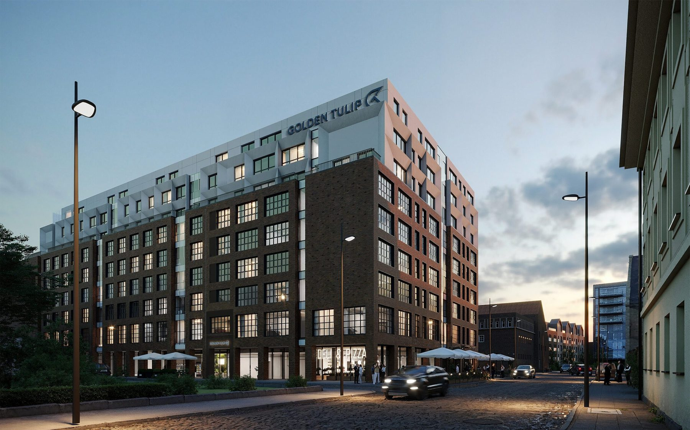

# 5. Hotel Golden Tulip · Chmielna 78 · Gdańsk

**Sekcja:** Golden Tulip · Chmielna 78  
**Nagłówek:** MARVIPOL DEVELOPMENT · 2023–2025

**Metryka:** 321 jednostek · Gdańsk · projekt prowadzony od 2024 · oddanie planowane na koniec 2027

Specjalistka ds. koordynacji projektów inwestycyjnych. Autorka projektu koncepcji hotelu.

---
Opis strony: Otwarcie rozdziału Golden Tulip: metryka inwestycji (321 jednostek, Gdańsk, 2024–2027). Podpisy zdjęć z IDML (edycja PL/EN).
