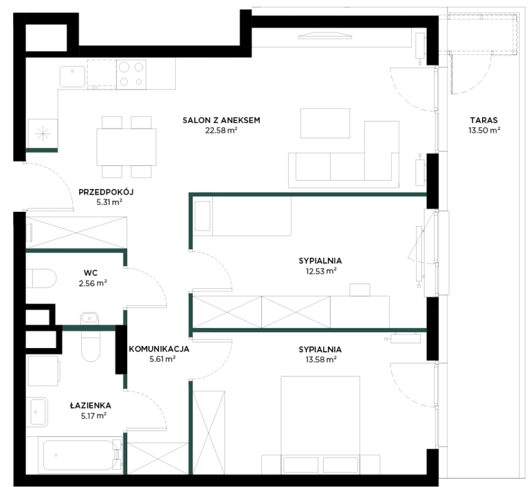
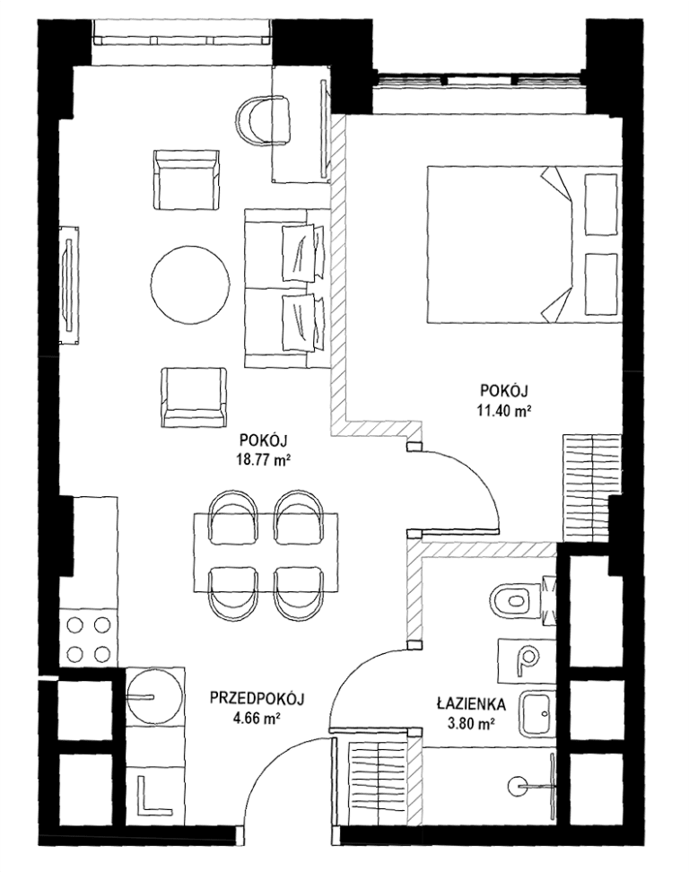

# 7. Poliwęglan komorowy i światło RGB

**Sekcja:** Golden Tulip · Chmielna 78  
**Nagłówek:** PROJEKT LOBBY

Materiał przewodni: poliwęglan komorowy. Projekt skupia się na ubraniu monochromatycznej przestrzeni wewnętrznej w instalacje oświetleniowe RGB.

Rzut LOBBY: wydzielone dwie strefy odpoczynku, strefa wind przysłonięta podświetlaną ścianą RGB, strefa lobby otwiera się na restaurację, komunikacja.

*Wizualizacja · mat. Marvipol Development*

---
Opis strony: Koncepcja lobby hotelu: materiał przewodni, instalacje RGB, opis rzutu lobby.
