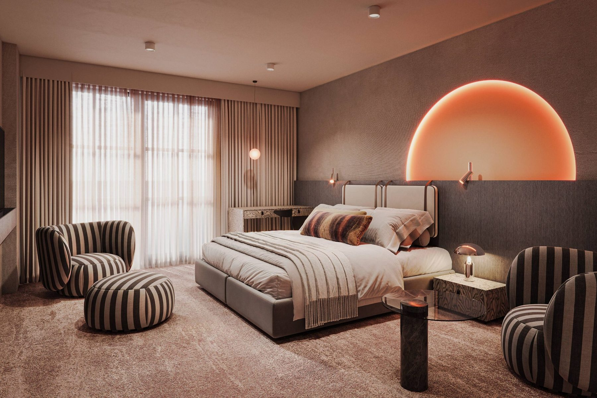
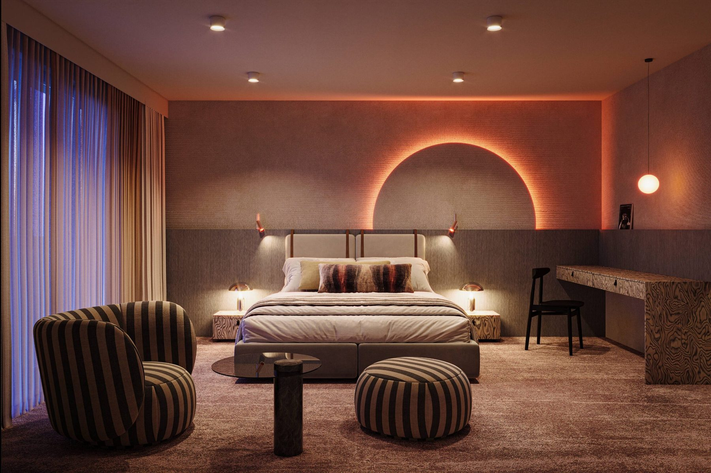
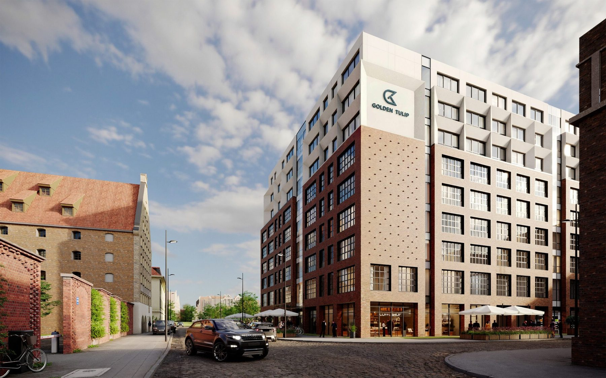

# 8. Lobby, recepcja, komunikacja, strefy usługowe, lokale

**Sekcja:** Golden Tulip · Chmielna 78  
**Nagłówek:** STREFY FIT-OUT

Zakres fit-outu obejmował lobby, recepcję, komunikację, strefy usługowe i wnętrza lokali. Wizualizacje pokazują pokoje w standardzie premium: monochromatyczna baza, akcenty świetlne w łuku, materiały dobrane pod eksploatację hotelową.

*WSPÓŁPRACA — Wizualizacje: arch. Filip Surowiecki, mat. Marvipol Development · Teksty katalogu: dział marketingu Marvipol Development we współpracy z autorką koncepcji.*

---
Opis strony: Strefy fit-outu i wizualizacje pokoi; nota o współpracy z arch. Filipem Surowieckim. Podpisy zdjęć z IDML (edycja PL/EN).
