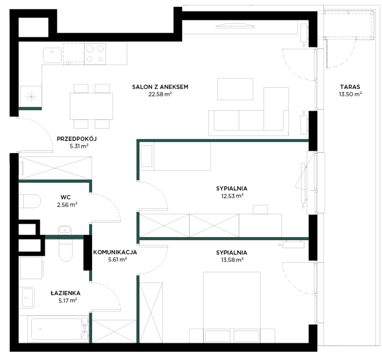
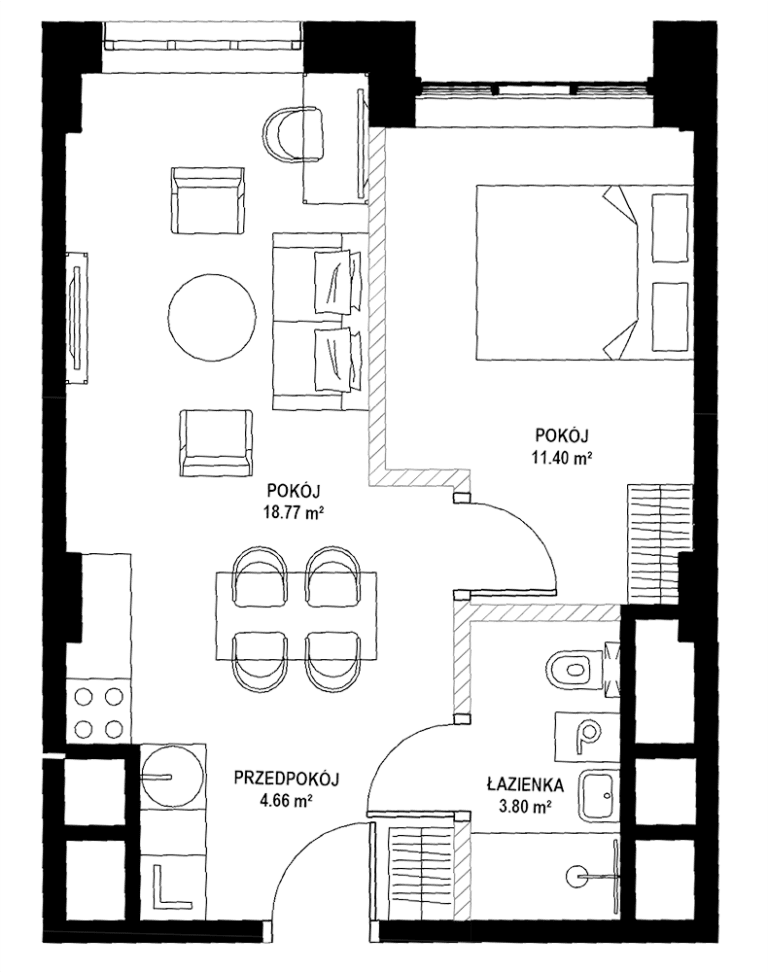

# 9. Fit-out, optymalizacja, narracja katalogu

**Sekcja:** Golden Tulip · Chmielna 78  
**Nagłówek:** MOJA ROLA · REZULTAT

## Moja rola

- Odpowiadałam za realizację fit-outu wnętrz: lobby, recepcji, komunikacji, stref usługowych i wnętrz lokali
- Prowadziłam proces optymalizacji materiałowej oraz negocjacje z dostawcami; decyzje zapadały wspólnie z Zarządem
- Nadzorowałam współpracę z biurami projektowymi i wykonawcami
- Odpowiadałam za koncepcję i architekturę narracji katalogu sprzedażowego
- Opracowywałam raporty i prezentacje strategiczne dla Zarządu
- Reprezentowałam firmę na spotkaniach z interesariuszami

## Rezultat

321 jednostek objętych zakresem inwestycji. Standard premium utrzymany mimo zawężenia budżetu — dzięki optymalizacji rozwiązań materiałowych zamiast obniżenia klasy wykończenia. Katalog sprzedażowy i materiały komunikacyjne wdrożone w kanałach inwestycji. Obiekt w budowie; oddanie planowane na koniec 2027 roku.

---
Opis strony: Lista odpowiedzialności w Marvipol Development i rezultat projektu Golden Tulip. Podpisy zdjęć z IDML (edycja PL/EN).
